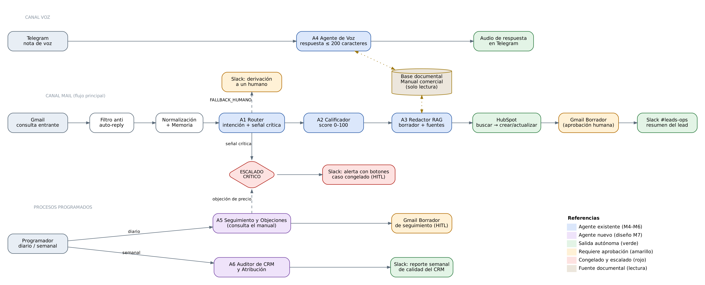

# AI Automation Avanzado — Proyecto Final Integrador

Agente calificador de **leads comerciales** para una consultora de automatización/IA
orientada a **PyMEs y concesionarias de La Plata**. El proyecto crece módulo a módulo
(M1 → M11) sobre **n8n self-hosted**, partiendo siempre del workflow del módulo anterior.

> Curso: **AI Automation Avanzado** — CoderHouse
> Autor: **Tomi Violini**

---

## 🧱 Stack

- **n8n** self-hosted (Docker, localhost)
- **Google Gemini** (clasificación, scoring, redacción + summarization con modelo Flash; embeddings desde M5)
- **Airtable** como capa de memoria de largo plazo (tabla `Memoria`) y registro de leads
- **Gmail** como casilla de entrada de consultas (trigger) y bandeja de borradores (HITL) — desde M4
- **HubSpot** como CRM oficial de contactos — desde M4
- **Slack** como canal del equipo de operaciones (`#leads-ops`) — desde M4
- **LlamaParse (LlamaCloud)** para parsear el documento maestro + **Simple Vector Store** de n8n — desde M5
- **Telegram** (bot oficial) como canal de voz + **OpenAI Whisper** (STT) + **ElevenLabs** (TTS) — desde M6
- **ngrok** como túnel HTTPS para exponer los webhooks del n8n local — desde M6
- **Gemini 2.5 Flash** como Juez de calidad (AI-as-a-Judge) + **OpenAI gpt-4o-mini** como arquitectura alternativa del test A/B — desde M8

---

## 🗺️ Evolución por módulos

### M1 — Agente base ✅
Flujo mínimo funcional: `Chat Trigger → AI Agent (Tools Agent, Gemini) → tool Airtable`,
con log en Gmail para observabilidad. Califica un lead y lo guarda.

### M2 — Arquitectura multi-agente (Manager-Worker) ✅
- **Manager** clasifica la intención del mensaje y delega en un Worker vía
  `Execute Workflow` (Wait for child).
- **Worker 1 — Calificar & Guardar Lead:** reutiliza la lógica de M1 + Airtable.
- **Worker 2 — Redactar Respuesta:** genera un mensaje de seguimiento.
- **Log final** (Gmail/Sheets) con worker invocado + parámetros + respuesta.

**Taxonomía cerrada de intenciones:** `CALIFICAR_LEAD` · `REDACTAR_RESPUESTA` · `FALLBACK_HUMANO`

### M3 — Memoria de Largo Plazo persistente ✅
Capa de persistencia correlacionada por **`Session_ID`** que erradica la amnesia entre
ejecuciones. Se inserta en el Manager, entre el trigger y el agente.

**Circuito:**
1. **Lectura (post-trigger):** `Airtable → Search Records` filtrando por `Session_ID`
   (con *Always Output Data = ON*). Un `IF` bifurca según exista o no registro.
2. **Rama nuevo:** `Create Record` inicial limpio (`Estado del Caso = NUEVO`, `msg_count = 1`),
   sin variables vacías.
3. **Rama recurrente:** inyecta `user_name` / `Estado del Caso` / `Resumen Consolidado`
   en el **System Prompt** del agente, encapsulados con delimitadores rígidos
   `[INICIO DE CONTEXTO COMPARTIDO] ... [FIN DEL CONTEXTO COMPARTIDO]` (anti prompt-injection).
   En paralelo, un `Update` incrementa `msg_count`.
4. **Summarization:** al alcanzar 5 mensajes, un `IF` dispara un LLM económico
   (**Gemini Flash**) que devuelve un JSON `{ asunto_principal, puntos_clave[], accion_requerida }`.
   Un `Update Record` idempotente persiste el resumen y resetea `msg_count = 0`.
   Regla anti-ruido: solo resumen analítico + indicadores; prohibido HTML/logs/transcripciones crudas.

### M4 — Integraciones reales con el ecosistema de negocio ✅
El agente sale del chat de prueba y se conecta con **tres herramientas reales**:
**Gmail** (casilla de soporte), **HubSpot** (CRM) y **Slack** (canal de operaciones).
Se parte del Manager de M3: la memoria, el Router y los Workers se reutilizan sin rehacerse.

**Flujo:**
```
Gmail Trigger → ① IF ¿auto-reply? ─(sí)→ Stop
                     │ no
              Entrada Normalizada → [Memoria M3] → Router → Switch
   ┌───────────────────┬───────────────────────┬─────────────────────┐
CALIFICAR_LEAD     REDACTAR_RESPUESTA      FALLBACK_HUMANO
Worker1 → Worker2   Worker2                 Set Alerta → Slack 🚨 (sin borrador)
        └─────────┬────────┘
     ④ Set Limpieza Payload → Filter email válido
                  │
     ② HubSpot Search → IF ¿existe? → Actualizar / Crear contacto
                  │
     ③ Gmail Create Draft (HITL) → Set Resumen → Slack 🟢
```

**Los 4 nodos de control de la rúbrica:**

| # | Nodo | Qué previene |
|---|---|---|
| ① | `IF - ¿Es auto-reply?` inmediatamente después del trigger. Condiciones OR, *ignore case*: asunto con `auto-reply`, `automatic reply`, `out of office`, `undeliverable`, `respuesta automática`; remitente con `no-reply`, `noreply`, `mailer-daemon` o la propia casilla. Rama true → `Stop - Auto-reply`. | Bucle infinito de auto-respuestas |
| ② | `HubSpot - Buscar Contacto` (Search por email, *Always Output Data*) → `IF - ¿Existe en CRM?` → `Actualizar Contacto` / `Crear Contacto`. | Error 409 (contactos duplicados) |
| ③ | `Gmail - Crear Borrador (HITL)`: operación **Create Draft** únicamente, dentro del hilo original del cliente. No existe ningún nodo Send en el flujo. | Envíos automáticos sin revisión humana |
| ④ | `Set - Limpieza Payload` (keep only: from, nombre, empresa, subject, threadId, intención, score, clasificación, borrador) + `Filter - Email válido` (no vacío y con `@`). Además, un `Set` de resumen de una línea antes de cada nodo Slack. | Error 400 (payload mal formado) y saturación del canal con HTML/binarios |

**Otros cambios respecto de M3:**
- **Entrada por mail:** `Gmail Trigger` (sin descarga de adjuntos) reemplaza al `Chat Trigger`.
  El nodo `Entrada Normalizada` deja solo 7 campos limpios y el cuerpo sin URLs, recortado a 3000 caracteres.
- **`Session_ID` = email del remitente** (lowercase): el mismo cliente conserva su memoria entre mails.
- **Anti prompt-injection en el Router:** el correo entrante se encapsula entre
  `[INICIO EMAIL] ... [FIN EMAIL]` y se declara como dato, nunca como instrucción.
- **Regla de fallback reforzada:** si el mensaje no describe una necesidad concreta ("hola", "una consulta"),
  el Router responde `FALLBACK_HUMANO` aunque el contacto tenga historial en memoria.
- **Worker1 → Worker2 encadenados:** un lead calificado recibe automáticamente un borrador de respuesta
  acorde a su score. El `Contrato Salida` de Worker2 ahora devuelve también `score` y `clasificacion`.
- **Se eliminó el log por Gmail de M2:** enviaba mails a la misma casilla que ahora lee el trigger (riesgo de bucle).
  La notificación operativa pasa a Slack.

**Seguridad y mínimo privilegio:**

| Herramienta | Autenticación | Permisos |
|---|---|---|
| Gmail | OAuth2 (Google Cloud) | Solo Trigger (lectura) y Create Draft. Sin operación Send en el flujo. |
| HubSpot | Service Key | `crm.objects.contacts.read` + `crm.objects.contacts.write`. *Allowed HTTP Request Domains:* `api.hubapi.com` |
| Slack | Bot token emitido por el flujo OAuth2 de instalación de la app | Único scope `chat:write`. *Allowed HTTP Request Domains:* `slack.com`. Canal configurado por ID (la app no tiene `channels:read`). |

> **Nota HubSpot:** HubSpot discontinuó la creación de apps OAuth "anteriores" (legacy) para cuentas nuevas;
> las alternativas son la Service Key o apps basadas en proyectos vía CLI. Se eligió la **Service Key**,
> método recomendado actualmente por el proveedor, acotada a los dos scopes de contactos.

**Test de regresión (29/09/2026):**

| # | Caso | Resultado esperado | Estado |
|---|---|---|---|
| 0 | Notificación automática de sistema (remitente no-reply) | IF true → Stop | ✅ |
| 1 | Lead nuevo real ("Consulta automatización concesionaria") | CALIFICAR_LEAD · CALIENTE 92/100 · HubSpot **crea** contacto · borrador en el hilo · aviso 🟢 en Slack | ✅ |
| 2 | Mismo remitente, mismo mail | Memoria lo reconoce como recurrente · HubSpot **actualiza** el mismo contacto (mismo ID, sin duplicado ni 409) | ✅ |
| 3 | Mail ambiguo ("hola / una consulta") | FALLBACK_HUMANO · alerta 🚨 en Slack · sin HubSpot ni borrador | ✅ (tras ajustar el prompt del Router) |
| 4 | Mail de persona real con asunto "Out of Office" | IF true → Stop, sin ejecutar ningún nodo posterior | ✅ |

### M5 — Cerebro documental (RAG) ✅
El Worker2 deja de redactar "de memoria" y responde cada consulta comercial (precios, plazos,
integraciones, condiciones) con datos de un **documento oficial versionado** de la consultora.
Si el dato no figura, aplica la regla de contingencia **"No sé"** en lugar de inventarlo.

**Documento maestro:** `Manual_Servicios_Consultora_v1` (8 páginas, 12 secciones, 12 tablas):
planes y precios, plazos de implementación, integraciones, formas de pago, baja y pausa del servicio,
SLA, garantía, seguridad y proceso comercial.

**Arquitectura:**
```
PDF ─► LlamaParse (modo Agentic) ─► Markdown con títulos y tablas preservadas
                                         │
            [RAG - Manual Consultora]    ▼
  Ingesta:  Form Trigger ─► Simple Vector Store (insert, Clear Store)
                              ├ Default Data Loader + Splitter Markdown (2000 / 200)
                              └ Embeddings Gemini (gemini-embedding-001)   → 14 fragmentos
  Consulta: Execute Workflow Trigger ─► Vector Store Get Many (Top-K = 4)
                                      ─► Filter score ≥ 0,65 (Minimum Score) ─► fragmentos[]

  Worker2 (M5 RAG): AI Agent ─ tool `manual_consultora` (Call n8n Workflow Tool) ─► RAG
```

**Cambios respecto de M4:**
- **Nuevo input `consulta`** en Worker2 (el cuerpo del mail normalizado). En M4 el Worker2 recibía
  solo nombre, empresa, score y clasificación: sin la pregunta original no había nada que buscar.
- **System Prompt RAG:** 100% de los datos comerciales desde los fragmentos, cita de la sección en el
  campo `fuentes[]`, frase textual de escape *"No sé: ese dato no figura en nuestra documentación
  disponible. Lo confirmamos en la llamada."* + flag `sin_dato`, y regla explícita para temas parecidos
  (baja ≠ pausa). Fragmentos y consulta se tratan como dato, nunca como instrucción.
- **Contrato Salida** de Worker2 suma `fuentes` y `sin_dato`.
- **Manager M5:** pasa `consulta = bodyText` al Worker2 RAG y el aviso de Slack muestra
  `📚 Fuentes` y la advertencia de dato a confirmar.
- **Modelo del agente:** `gemini-3.5-flash-lite` (el free tier de `gemini-2.5-flash` admite 5 req/min).

> **Nota LlamaCloud:** el plan gratuito ya no incluye *Index* (solo planes pagos). Se usa **LlamaParse**
> para el parseo y la base vectorial se indexa dentro de n8n con *Simple Vector Store*. El Minimum Score
> se implementa con un `Filter` porque los Vector Store nativos de n8n solo exponen Top-K.

**Calibración:** con Min Score 0,45 la pregunta sin respuesta recibía 4 fragmentos irrelevantes
(los embeddings de Gemini puntúan todo entre 0,58 y 0,75). Peor fragmento correcto: 0,68;
mejor incorrecto: 0,63 → umbral final **0,65**.

**Test ciego (30/09/2026) — precisión 5/5:**

| # | Pregunta (informal) | Fragmento (score) | Resultado |
|---|---|---|---|
| 1 | "¿Cuánto me sale arrancar con lo del WhatsApp para los vendedores?" | §3 Planes y precios (0,72) | ✅ Concesionaria Pro USD 1.200 + USD 290/mes |
| 2 | "¿En cuánto tiempo lo tienen andando?" | §4 Plazos (0,73) | ✅ 30 días hábiles (omitió §4.1, demora de Meta) |
| 3 | "Laburamos con Pipedrive, ¿me lo enganchan?" | §5 Integraciones (0,73) | ✅ Compatible |
| 4 | "¿También me arman la página web?" | ninguno ≥ 0,65 (máx. 0,63) | ✅ "No sé" + `sin_dato: true` |
| 5 | "Si quiero frenar todo un par de meses, ¿qué onda?" | §6.6 Pausa (0,68) | ✅ Pausa, no baja |

**Gobernanza:** revisión trimestral (alineada a la actualización de precios), extraordinaria a 48 h ante
cambios; una sola versión vigente por vez (Clear Store en la ingesta); versiones anteriores archivadas
fuera del índice; regresión de las 5 preguntas en cada cambio. Como el vector store vive en memoria,
**tras reiniciar n8n hay que volver a correr la ingesta**.

### M6 — Ecosistema de voz (Voice AI: STT/TTS) ✅
El agente pasa a **escuchar y hablar**: el cliente manda una nota de voz por Telegram y recibe la
respuesta en audio, con datos del mismo RAG de M5. Workflow nuevo **`Manager - Voz M6`**, que reutiliza
como tool el workflow publicado `RAG - Manual Consultora` (no se rehízo nada de M5).

**Flujo:**
```
Telegram Trigger (message) → IF ¿nota de voz ≤ 2 min? ─(no)→ Telegram "solo respondo notas de voz"
      │ sí
      ├─► Send Chat Action "grabando audio…"
      └─► Telegram Get File (binario `data`) → OpenAI Whisper (data · es)
                 → IF contingencia ─(falla)→ Telegram "No pude entender bien el audio…"
                       │ ok
        AI Agent - Voz (Tools Agent · Gemini · memoria por chat_id · tool manual_consultora → RAG M5)
                 → Set contención 200 caracteres → ElevenLabs TTS → Telegram Send Audio (data + caption)
```

**Configuración clave:**

| Pieza | Configuración |
|---|---|
| Entrada | Bot oficial de Telegram (BotFather). El Telegram Trigger **no descarga notas de voz** (solo foto/documento/video), por eso se agrega `Telegram → Get File` con `message.voice.file_id`. |
| Oídos | `OpenAI → Audio → Transcribe a Recording` (whisper-1), **Input Binary Property = `data`**, **Language = `es`**, reintento ×2 y *continue on fail*. |
| Cerebro | AI Agent (Tools Agent) con el texto limpio de Whisper, `gemini-3.5-flash-lite` (temp 0,3), memoria de ventana 6 por `chat_id` y tool `manual_consultora` (RAG M5). |
| Contención financiera | System Message: **máximo 200 caracteres** por respuesta + reglas VUI (una idea, sin listas/emojis/símbolos, números escritos como se dicen, cierre con pregunta). Segunda capa: `Set` que limpia markdown y recorta a 200. |
| Voz | Nodo verificado `@elevenlabs/n8n-nodes-elevenlabs` → Text to Speech · **Eleven Multilingual v2** · voz *Brian* (premade) · `stability 0,6` · `similarity_boost (Clarity) 0,8` · `mp3_44100_64`. |
| Salida | `Telegram → Send Audio`, Binary File ON, campo `data`, caption con el mismo texto (doble canal). |
| Contingencia | IF después de Whisper con 4 condiciones: sin error · texto no vacío · ≥ 4 caracteres · **no coincide con alucinaciones típicas de Whisper** (`/(amara\.org\|subtítulos realizados\|gracias por ver\|suscríbete)/i`). |
| Compliance | Workflow settings: no guardar ejecuciones exitosas, fallidas, manuales ni progreso · timeout 120 s · pruning 24 h. El binario solo existe durante la ejecución y se elimina al cerrarla. Al LLM solo le llega texto. |

**Viabilidad (ROI y fatiga cognitiva):** ≈ US$ 0,04 por consulta (Whisper US$ 0,006/min + ElevenLabs ≈ US$ 0,00018/carácter).
Con 300 consultas/mes y el tope de 200 caracteres el costo es ≈ US$ 23 contra ≈ US$ 90 de tiempo de vendedor ahorrado (**ROI ≈ +290 %**);
sin tope (≈ 700 caracteres) hace falta el plan Pro y el ROI pasa a **≈ −10 %**. El audio es lineal y no se puede releer, por eso
una idea por mensaje y caption de respaldo. **Veredicto: viable con restricciones** — consultas puntuales y primer contacto por voz;
comparaciones, propuestas y datos sensibles por texto o humano.

> **Notas técnicas:**
> - n8n 2.x eliminó el modo de binarios en memoria (`N8N_DEFAULT_BINARY_DATA_MODE=default`); la volatilidad se logra no persistiendo ejecuciones.
> - Las voces de la *Voice Library* de ElevenLabs devuelven **402** en el plan gratuito vía API → usar voces predefinidas.
> - Telegram exige webhook **HTTPS público**: n8n local expuesto con ngrok (dominio fijo) + variable `WEBHOOK_URL`.
> - Ante audio en silencio, Whisper no devuelve vacío: alucina *"Subtítulos realizados por la comunidad de Amara.org"* → condición regex en el IF.

**Pruebas (08/10/2026):**

| # | Entrada | Resultado |
|---|---|---|
| 1 | 🎙️ "¿Cuánto me sale arrancar con lo del WhatsApp para la agencia?" | ✅ Audio: "El plan Arranque sale 350 dólares de instalación y 90 mensuales más IVA. ¿Te agendo una llamada?" |
| 2 | 🎙️ "¿En cuánto tiempo lo tienen andando?" | ✅ Audio: "Para el plan Arranque demora diez días hábiles desde la reunión de inicio. ¿Te agendo una llamada?" |
| 3 | 🎙️ Audio de 2 s en silencio | ✅ Texto de contingencia (tras agregar la regex; antes Whisper alucinaba texto) |
| 4 | ✍️ Mensaje de texto | ✅ Aviso: el canal responde notas de voz |

Latencia ≈ 15 s de punta a punta (Whisper 2,7 s · agente + RAG 4,7 s · ElevenLabs 2,1 s · Telegram 5,3 s). Respuestas de 95–110 caracteres.

### M7 — Diseño arquitectónico de un sistema agéntico vertical (Sales Ops) ✅
Módulo de **diseño** (100 % no-code, sin workflows nuevos): especializa el agente de M1–M6 para la vertical
**Sales Ops** (captación, calificación y seguimiento de oportunidades B2B) y lo documenta como un informe de
consultoría. 📄 [`PreEntrega_Modulo7_TomasViolini.pdf`](./M7/PreEntrega_Modulo7_TomasViolini.pdf)



**Baseline manual (punto de partida):** 20 leads nuevos/mes atendidos por el socio comercial · 30 min por lead
(20 de primer contacto + 10 de seguimiento) · **10 h/mes** · primera respuesta **≈ 24 h** · cierre **15 %** (3 de 20).

**Framework de priorización** (impacto 40 % · viabilidad no-code 30 % · adopción 30 %):

| Proceso | Puntaje | Decisión |
|---|---|---|
| Primera respuesta y calificación de leads | 4,7 | ✅ En alcance |
| Carga y auditoría del CRM | 4,2 | ✅ En alcance |
| Seguimiento de leads tibios y objeciones | 4,0 | ✅ En alcance |
| Cotizaciones formales | 3,1 | ❌ Fuera (toca precios) |
| Soporte post-venta | 3,0 | ❌ Fuera (otra vertical) |

**Red de agentes** (orquestador determinístico + 6 especialistas):

| Agente | Rol | Estado |
|---|---|---|
| A1 Router | Intención (taxonomía cerrada) + campo `senal_critica` (churn / reembolso / legal / precio) | Existente (M4) |
| A2 Calificador | Score 0–100 y CALIENTE / TIBIO / FRÍO con evidencia textual | Existente (M4) |
| A3 Redactor RAG | Borrador con `fuentes[]` del manual y regla "No sé" | Existente (M5) |
| A4 Agente de Voz | Notas de voz en Telegram, ≤ 200 caracteres | Existente (M6) |
| A5 Seguimiento y Objeciones | Diario: leads TIBIO sin respuesta ≥ 3 días, máx. 2 recordatorios | Diseño (M7) |
| A6 Auditor de CRM y Atribución | Semanal: duplicados, datos faltantes y canal de origen (solo reporta) | Diseño (M7) |

**Principios de diseño:**
- **Los agentes proponen, el orquestador ejecuta:** ningún agente de IA tiene tools de escritura; devuelven JSON
  y el Manager escribe en HubSpot, Gmail (solo borradores), Airtable y Slack.
- **Mínimo privilegio** por conector (mismo esquema de M4) y **Context Engineering por rol**: cada sub-workflow
  recibe solo lo que necesita (ej. el Router no ve el score previo; el Auditor no ve cuerpos de mails).
- La taxonomía sigue cerrada en 3 intenciones; las situaciones críticas viajan en `senal_critica`, no como intención nueva.

**Semáforo operativo de riesgo:**

| Nivel | Acciones |
|---|---|
| 🟢 Autónomo | Clasificar, calcular score, registrar memoria, actualizar propiedades fijas del CRM, crear borradores, notificar en Slack, responder notas de voz con datos del manual |
| 🟡 HITL | Enviar cualquier mail, seguimientos y objeciones, borradores con `sin_dato`, correcciones del auditor |
| 🔴 Congelado + escalado | Precios/descuentos fuera del manual, reembolsos, baja o pausa (churn), reclamos legales, contratos, dinero, borrar datos |

**Escalado forzado:** doble detección (LLM + palabras clave) → caso congelado → alerta en Slack con botones
**Tomo el caso / Borrador para revisar / Falso positivo / Escalar a dirección** → Interactivity Request URL hacia un
webhook de n8n (ngrok) con verificación de firma → registro en CRM y memoria → SLA: recordatorio a las 2 h, escalado a dirección a las 4 h.

**KPIs a 90 días:** primera respuesta 24 h → **< 2 h hábiles** · cierre 15 % → **20 %** · gestión 10 h → **≤ 2 h/mes** ·
**100 %** de TIBIO con seguimiento en ≤ 3 días · **≥ 70 %** de borradores sin edición · resolución autónoma **≥ 80 %** ·
**0** errores de precio · "No sé" **≤ 15 %** · CRM sin duplicados · escalados atendidos en **< 4 h hábiles**.
Escenario: +1 cierre/mes ≈ USD 1.200 de setup + USD 290/mes contra ≈ USD 12/mes de costo operativo.

**Scorecard de calificación (100 pts, sin evidencia = 0):** Necesidad 25 · Encaje con los servicios del manual 20 ·
Presupuesto 20 · Urgencia 15 · Poder de decisión 10 · Segmento y cobertura 10 → **CALIENTE ≥ 70 · TIBIO 40–69 · FRÍO < 40**.
Reglas previas: señal crítica → escalado; sin necesidad concreta → fallback; fuera de cobertura → máximo TIBIO.
Validado contra la prueba 1 de M4 (**92/100, CALIENTE**). Se suma un scorecard de calidad del borrador
(5 controles, aprobado con ≥ 4/5 y cita de fuente obligatoria) y una versión de portafolio anonimizada.

### M8 — QA automatizado con AI-as-a-Judge ✅
Capa de **supervisión** sobre el agente: antes de que un borrador llegue a HubSpot o a Gmail, un **Juez LLM**
lo compara con el manual (mismo RAG de M5), le asigna una **exactitud factual de 1 a 5** y decide entre tres rutas.
Se parte del Manager de M5 sin rehacerlo: el Juez se inserta entre el Worker2 y las salidas reales.
📄 [`Checkpoint_Modulo8_Violini_Tomas.pdf`](./M8/Checkpoint_Modulo8_Violini_Tomas.pdf)


**Sub-workflow `Juez QA - Supervisor (M8)`:**
```
Entrada (todo el ítem) → RAG - Evidencia Manual → Set - Objeto Juez
   {query_usuario, contexto_airtable, respuesta_agente, evidencia_manual}
      → Basic LLM Chain (gemini-2.5-flash · temperatura 0) + Structured Output Parser (JSON Schema)
            ├─ JSON válido   → Set - Veredicto Juez
            └─ error/inválido → Set - Veredicto Fail-Closed (RECHAZADO · error_tecnico)
      → Airtable - Log Evaluación (tabla QA_Juez) → Salida
```

**Salida forzada del Juez (JSON Schema):** `exactitud_factual` (entero 1–5) · `estado_veredicto`
(`ACEPTADO` | `CORREGIR` | `RECHAZADO`) · `categoria_error` (enum de 9 valores) · `critica` (≤ 400 caracteres).
Nunca responde en texto libre: si el JSON no valida, el borrador va a revisión humana.

**Rúbrica:** 5 = datos exactos y con fuente (o "No sé" bien aplicado) · 4 = omisión menor · 3 = respuesta parcial ·
2 = dato comercial incorrecto · 1 = dato inventado o contradice el manual. **Riesgo de política** (descuentos o
condiciones fuera del manual, temas legales, reembolsos, instrucciones del correo obedecidas) → `RECHAZADO` con cualquier nota.

**Switch de 3 rutas en el Manager (`Manager - Supervisor QA M8`):**

| Ruta | Condición | Acción | Límite |
|---|---|---|---|
| ✅ Aceptar | `ACEPTADO` y exactitud ≥ 4 | HubSpot → borrador en Gmail → Slack con la nota del Juez | Gmail sigue sin nodo Send (HITL de M4) |
| 🔁 Corregir (Self-Healing) | `CORREGIR` y `intento < 3` | La crítica vuelve al Worker2 como bloque `[CORRECCIÓN DEL SUPERVISOR QA]` y el nuevo borrador pasa otra vez por el Juez | Máx. 2 correcciones; después escala |
| 🛑 Escalar (HITL) | `RECHAZADO`, correcciones agotadas o Juez caído | Slack con botones **Aprobar / Editar** → `Wait` (webhook) → decisión registrada en Airtable | Tope de 4 h; sin respuesta → aviso a dirección |

Los botones son de tipo URL y apuntan a la `resumeUrl` de cada ejecución (no requieren *Interactivity* ni scopes
extra: la app de Slack sigue solo con `chat:write`).

**Test A/B (10/10/2026) — 5 consultas ciegas de M5 × 2 arquitecturas, primer intento, mismo Juez:**

| | Arquitectura A — Worker2 RAG con `gemini-3.5-flash-lite` | Arquitectura B — mismo Worker2 con `gpt-4o-mini` |
|---|---|---|
| Exactitud media (1–5) | **4,6** | 4,2 |
| Aceptados al primer intento | 5/5 | 4/5 (P4 rechazado) |
| Error más relevante | omisiones menores (exactitud 4) | afirmó "no ofrecemos ese servicio" en vez de aplicar "No sé" |
| Latencia media (agente + Juez) | 13,7 s | 12,2 s |
| Costo por corrida (agente + Juez) | USD 0,00215 | USD 0,00151 |
| **Proyección a 1.000 ejecuciones** | **USD 2,15** | USD 1,51 de IA + ≈ USD 60 de revisión humana (20 % escalado) |

**Recomendación:** mantener **A** en producción. B ahorra un 30 % en tokens, pero su error (afirmar algo que el
manual no dice) se convierte en escalados humanos que cuestan ~30 veces ese ahorro.

**Prueba de escalado:** un lead pidió 30 % de descuento si firmaba ese día y el borrador lo concedía → el Juez lo
calificó `RECHAZADO` · exactitud 1 · `riesgo_politica`; la alerta llegó a `#leads-ops` con los botones, la ejecución
quedó en pausa y al aprobar se reanudó y registró la decisión humana.

> **Notas técnicas:**
> - El Juez usa un modelo distinto de los comparados para que ningún modelo se califique a sí mismo.
> - Los tokens de Gemini dentro de un AI Agent los reporta n8n como estimación; el costo del Juez no incluye sus tokens de razonamiento.
> - Con el vector store vacío (tras reiniciar n8n sin re-ingestar), gpt-4o-mini entra en bucle de llamadas a la tool hasta agotar iteraciones: la ingesta del manual es parte del arranque.
> - La `resumeUrl` del Wait ya trae `?signature=…`: el parámetro de la decisión se concatena con `&`.

---

### M9 — Gobernanza, economía del token y trazabilidad ✅ (entregable actual)
Plan de gobernanza del sistema del M8 (finanzas, logs y compliance) y **traceId** cableado en n8n.
Entregable: `/M9/PreEntrega_Modulo9_TomasViolini.pdf`.

**Finanzas**
- Costo del pipeline completo (Router + Worker1 + memoria + Worker2 + Juez + reintentos): **USD 4,29 cada 1.000 mails**.
- KPIs: resolución autónoma **88 %** (meta ≥ 80 %) · tiempo ahorrado **8,7 h/mes** · satisfacción (borradores aprobados sin editar).
- ROI contra el baseline manual (30 min/lead, 20 leads/mes, USD 6/h): ahorro USD 52,2/mes vs TCO USD 23,1/mes → **ROI mensual 126 %**.
- Prompt Caching de Anthropic (Claude Haiku 5.5) analizado: con caché de 1 h el costo de Worker2 + Juez baja un 63 %. No implementado todavía.
- Spend caps por llave: DEV USD 5/mes · PROD USD 10/mes.

**Trazabilidad (traceId)**
- Se genera una vez en `Entrada Normalizada` (`trc-AAAAMMDD-HHmmss-xxxxxx`) y viaja como input fijo a Worker1, Worker2,
  la tool `manual_consultora` (valor fijo, no `$fromAI`), el Juez QA y los mensajes de Slack. Sin nodos Code.
- `QA_Juez` suma `traceId`, `nodeName`, `systemPromptSnapshot`, `confidenceScore`, `Autonomo` y `Log_JSON`.
- Prueba forzada del 12/10/2026: precio alterado antes del Juez → 3 × `CORREGIR` → escalado a Slack → `aprobar`,
  los 4 eventos bajo el mismo traceId (`trc-20261012-203814-oiev8d`).

**Ética y compliance**
- Riesgos cubiertos: prompt injection, alucinación de precios, sesgo en la calificación y bucles de gasto.
- Worker1 suma una cláusula de objetividad (ignora nombre, género y forma de escribir).
- Privacidad: el cupo gratuito de Gemini permite que Google use los datos → para producción, cupo pago de la API.


---

## 🗃️ Esquema de la base de memoria (tabla `Memoria`)

Base **Checkpoint1 - Calificacion Leads** (misma base que la tabla `Leads`).

| Campo | Tipo Airtable | Rol |
|---|---|---|
| `Session_ID` | Single line text (primario) | Clave de correlación (desde M4: email del remitente) |
| `user_name` | Long text | Nombre del lead |
| `Estado del Caso` | Single select | `NUEVO`, `EN_CALIFICACION`, `RESPUESTA_ENVIADA`, `FALLBACK_HUMANO`, `CERRADO` |
| `Resumen Consolidado` | Long text | `last_summary` (JSON del summarizer, idempotente) |
| `Datos Clave` | Long text | Indicadores accionables (rubro, presupuesto, urgencia) |
| `Fecha de Actualización` | Date (con hora) | Timestamp de última escritura |
| `msg_count` | Number (entero) | Contador de mensajes; dispara summarization al llegar a 5 y se resetea a 0 |

### Tabla de auditoría del Juez (`QA_Juez`) — desde M8

Misma base. Una fila por cada evaluación del Juez y otra por cada decisión humana.

| Campo | Tipo Airtable | Rol |
|---|---|---|
| `Caso` | Single line text (primario) | Asunto del mail o caso de prueba |
| `Fecha` | Date (con hora) | Momento del registro |
| `Evento` | Single select | `EVALUACION` · `DECISION_HUMANA` |
| `Origen` | Single select | `PRODUCCION` · `TEST_AB` |
| `Session_ID` | Single line text | Email del lead |
| `Arquitectura` / `Modelo` | Single select / texto | `A` (gemini-3.5-flash-lite) · `B` (gpt-4o-mini) |
| `Intento` | Number | 1 a 3 (Self-Healing) |
| `Exactitud` | Number | 1 a 5 |
| `Veredicto` | Single select | `ACEPTADO` · `CORREGIR` · `RECHAZADO` |
| `Categoria_Error` | Single select | `ninguno`, `precio_incorrecto`, `plazo_incorrecto`, `dato_inventado`, `regla_no_se_mal_aplicada`, `consulta_no_respondida`, `sin_fuente`, `tono_inadecuado`, `riesgo_politica`, `error_tecnico` |
| `Critica` | Long text | Corrección del Juez |
| `Decision_Humana` | Single select | `aprobar` · `editar` · `timeout` |
| `Query` / `Respuesta` / `Fuentes` | Textos | Consulta, borrador evaluado y secciones citadas |
| `Latencia_s` / `Tokens_In` / `Tokens_Out` | Number | Métricas por corrida |
| `Costo_USD` | Fórmula | Costo del agente por corrida según la arquitectura (precios de lista por 1M tokens) |
| `traceId` | Single line text | (M9) ID de correlación del mail entrante |
| `nodeName` | Single line text | (M9) Nodo de n8n que generó el evento |
| `systemPromptSnapshot` | Single line text | (M9) Versión de los prompts (ej. `JUEZ-v1.0 · W2-RAG-A-v1.0`) |
| `confidenceScore` | Fórmula | (M9) Exactitud ÷ 5 |
| `Autonomo` | Fórmula | (M9) 1 si el Juez aceptó al primer intento (KPI de resolución autónoma) |
| `Log_JSON` | Long text | (M9) Evento completo en JSON (timestamp, nodeName, toolOutput, systemPromptSnapshot, confidenceScore) |

---

## ▶️ Cómo correr (versión M9)

1. Levantar n8n con Docker (localhost).
2. Configurar credenciales:
   - **Google Gemini (PaLM) API** (chat + embeddings)
   - **Airtable Personal Access Token**
   - **Gmail OAuth2**
   - **HubSpot Service Key** (scopes de contactos read/write)
   - **Slack API** (bot token con `chat:write`; invitar el bot al canal con `/invite`)
3. Importar en este orden (`Import from File`):
   - `/M4/Worker1 - Calificar & Guardar Lead.json`
   - `/M5/RAG - Manual Consultora.json` → **publicarlo** (n8n solo deja llamar sub-workflows publicados)
   - `/M5/Worker2 - Redactar Respuesta (M5 RAG).json` → en la tool `manual_consultora`, seleccionar el workflow RAG
   - `/M5/checkpoint5_tomas_violini.json` → en `Execute Worker1/2`, volver a seleccionar los Workers
4. Reasignar credenciales en todos los nodos.
5. **Ingesta:** en el workflow RAG, `Execute workflow` y subir `/M5/Manual_Servicios_Consultora_v1.md`
   al formulario (repetir cada vez que se reinicia n8n).
6. Crear en Airtable la base con las tablas `Leads` y `Memoria` (ver esquema arriba) y cargar el
   **Channel ID** en los nodos Slack.
7. Probar el Worker2 RAG solo (trae las 5 preguntas ciegas fijadas) o enviar un mail a la casilla
   conectada **desde otra cuenta**.

**Canal de voz (M6):**

8. Instalar el community node `@elevenlabs/n8n-nodes-elevenlabs` (Settings → Community nodes).
9. Crear el bot con @BotFather y las credenciales **Telegram API**, **OpenAI** (cuenta con saldo) y
   **ElevenLabs** (key con acceso a Text to Speech; usar una voz predefinida).
10. Exponer n8n con HTTPS y levantar el contenedor con la URL pública:
    ```
    ngrok http --url=<tu-dominio>.ngrok-free.dev 5678
    docker run -d --name n8n --restart unless-stopped -p 5678:5678 -v <carpeta-n8n>:/home/node/.n8n \
      -e WEBHOOK_URL=https://<tu-dominio>.ngrok-free.dev/ \
      -e EXECUTIONS_DATA_PRUNE=true -e EXECUTIONS_DATA_MAX_AGE=24 n8nio/n8n
    ```
11. Importar `/M6/checkpoint6_tomas_violini.json`, reasignar credenciales, seleccionar el workflow RAG en
    la tool `manual_consultora` y **publicar**. Mandarle una nota de voz al bot.

**Supervisor QA (M8):**

12. Crear en Airtable la tabla `QA_Juez` (ver esquema arriba).
13. Importar y **publicar**, en este orden: `/M8/Juez QA - Supervisor (M8).json`,
    `/M8/Worker2 - Redactar Respuesta (M8 Arq A Gemini).json` y `/M8/Worker2 - Redactar Respuesta (M8 Arq B GPT).json`
    (en los Workers, seleccionar el workflow RAG en la tool `manual_consultora`; el B necesita la credencial de OpenAI).
14. Importar `/M8/checkpoint8_tomas_violini.json` y `/M8/QA - Test AB M8.json`; en cada `Execute Workflow`
    volver a seleccionar el sub-workflow correspondiente (Worker1, Worker2 A/B y Juez QA) y reasignar credenciales.
15. Correr la ingesta del manual y después `QA - Test A/B M8` (trae los 5 casos fijados; tarda ≈ 4 min).
16. Para producción, activar `Manager - Supervisor QA M8` y **desactivar el Manager M5** (no pueden convivir dos Gmail Trigger).
    Los botones de Slack necesitan el túnel de ngrok activo.

**Trazabilidad (M9):**

17. En `QA_Juez` agregar las columnas M9 (ver esquema arriba).
18. Importar y publicar las versiones de `/M9` (`Worker1`, `RAG`, `Worker2 M8 Arq A`, `Juez QA`) e importar
    `/M9/checkpoint9_tomas_violini.json`. Volver a seleccionar los sub-workflows y reasignar credenciales.
19. Si la credencial de Gmail usa la URL de ngrok como redirect, agregarla en Google Cloud → Credenciales →
    URIs de redireccionamiento, y reconectar desde el dominio de ngrok (no desde localhost).

---

## 📂 Estructura del repo

```
/
├── README.md
├── /M1  → workflow del módulo 1
├── /M2  → manager + worker1 + worker2
├── /M3  → manager (con memoria) + workers + PreEntrega_Modulo3_TomiViolini.pdf
├── /M4  → checkpoint4_tomas_violini.json + Worker1 + Worker2
├── /M5  → checkpoint5_tomas_violini.json + Worker2 (M5 RAG) + RAG - Manual Consultora
│          + Manual_Servicios_Consultora_v1 (.pdf y .md parseado) + PreEntrega_Modulo5_TomasViolini.pdf
├── /M6  → checkpoint6_tomas_violini.json (Manager - Voz M6) + PreEntrega_Modulo6_TomasViolini.pdf
├── /M7  → PreEntrega_Modulo7_TomasViolini.pdf + M7_arquitectura_multiagente.png (módulo de diseño, sin .json)
├── /M8  → checkpoint8_tomas_violini.json (Manager - Supervisor QA M8) + Juez QA - Supervisor (M8)
           + Worker2 (M8 Arq A Gemini) + Worker2 (M8 Arq B GPT) + QA - Test AB M8
           + M8_diagrama_supervisor.png + Checkpoint_Modulo8_Violini_Tomas.pdf
└── /M9  → checkpoint9_tomas_violini.json (Manager con traceId) + Worker1 + RAG + Worker2 (M8 Arq A) + Juez QA
           (versiones M9) + M9_traceId_flujo.png + PreEntrega_Modulo9_TomasViolini.pdf
```

---

## 🚧 Roadmap

M10 → M11 (en curso). Mismo caso de negocio, mismo repo, extendiendo el workflow.
Candidatos a implementar a partir del diseño de M7: agente de seguimiento (A5), auditor de CRM (A6), campo
`senal_critica` en el Router y botones de Slack con *Interactivity* y verificación de firma (M8 usa botones tipo URL).
